# TryHackMe: SOC Level 1 - Introduction to Phishing Case Studies

## About the Project

This repository contains my practical incident analysis, alert triage, and case reports from the **Introduction to Phishing** room on TryHackMe. The goal of this project is to practice SOC Tier 1 responsibilities, including Splunk log analysis, threat intelligence checking, and alert classification (True Positive vs. False Positive) using the 5Ws methodology.

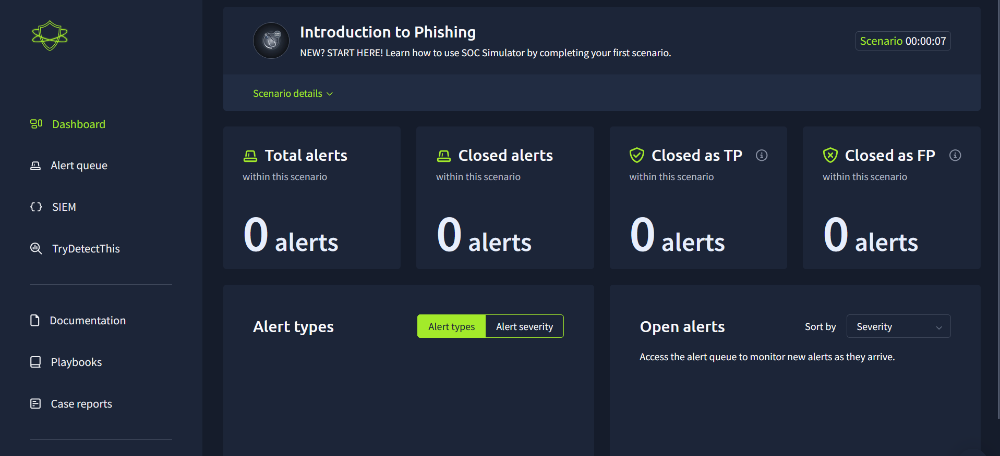

## Tools & Technologies Used

- **SIEM / Log Analysis:** Splunk (Email & Firewall logs)
- **Threat Analysis:** URL/IP Security Check (TryDetectThis)
- **Frameworks & Methodologies:** 5Ws Framework (Who, What, Where, When, Why), Incident Triage, MITRE ATT&CK (Phishing)

## Case Studies & Investigations

### Case 1: Alert #8814 – Inbound HR Onboarding Email

- **Incident Status:** False Positive
- **Affected User:** Julian Garcia (`j.garcia@thetrydaily.thm` | IP: `10.20.2.8`)
- **Sender:** `onboarding@hrconnex.thm`
- **My Analysis & Findings:**

* Investigated the incoming email, checked the URL using an internal tool, and confirmed it is legitimate

* **Evidence & Logs:**
  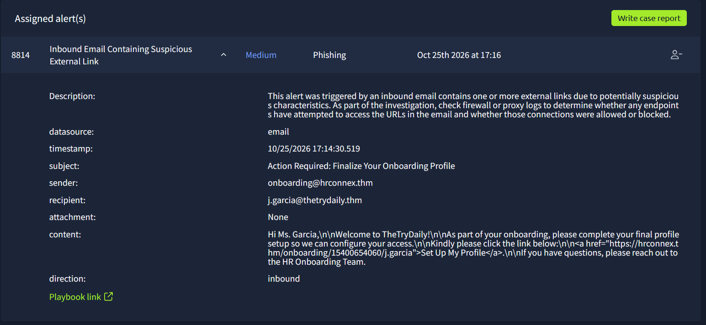
  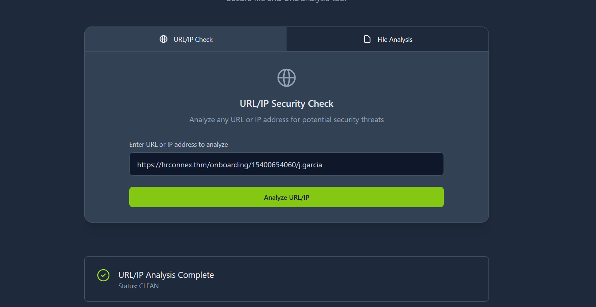

* **Final Report:**
  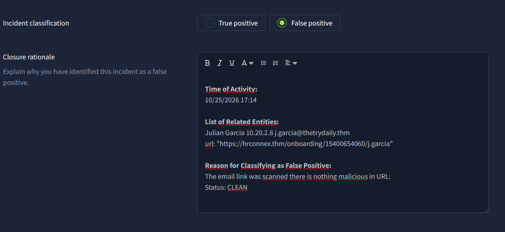

---

### Case 2: Alert #8815 – Inbound Amazon Phishing Email

- **Incident Status:** True Positive (Email detection)
- **Affected User:** Hannah Harris (`h.harris@thetrydaily.thm` | Workstation IP: `10.20.2.17`)
- **Sender:** `urgents@amazon.biz` (Impersonating Amazon)
- **My Analysis & Findings:**

* Detected a phishing email utilizing a Bitly link and urgency tactics

* **Evidence & Logs:**
  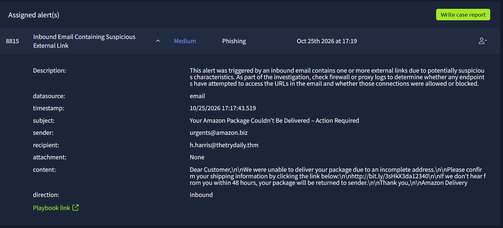
  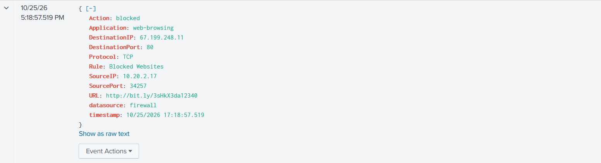

* **Final Report:**
  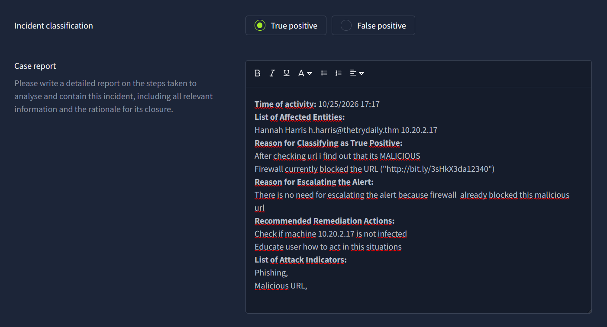

---

### Case 3: Alert #8816 – Firewall Block on Malicious External URL

- **Incident Status:** True Positive (Blocked by Perimeter)
- **Affected User:** Hannah Harris (`10.20.2.17`)
- **Target URL:** `http://bit.ly/3sHkX3da12340` (Destination IP: `67.199.248.11`)
- **My Analysis & Findings:**

* Firewall successfully blocked the connection under rule "Blocked Websites"

* **Evidence & Logs:**
  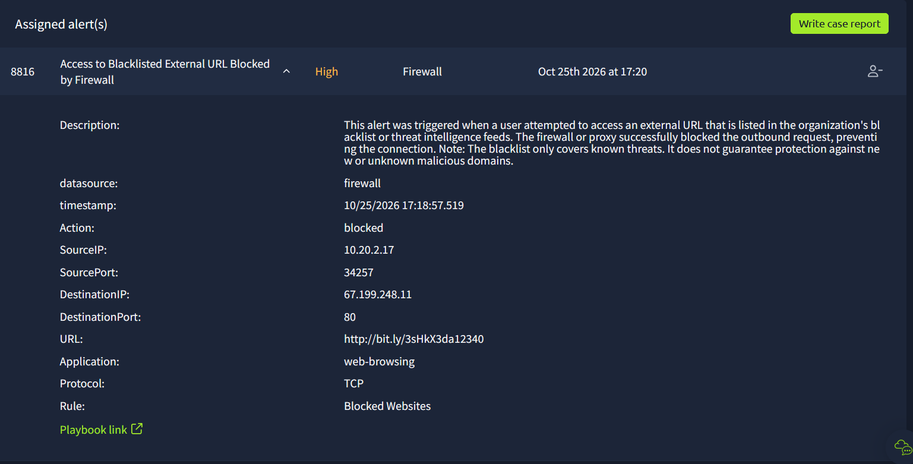

* **Final Report:**
  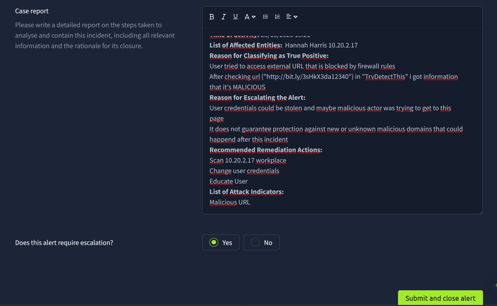

---

### Case 4: Alert #8817 – Microsoft Credential Phishing (Active Incident)

- **Incident Status:** True Positive (Escalation / Action Required)
- **Affected User:** Charlotte Allen (`c.allen@thetrydaily.thm` | Workstation IP: `10.20.2.25`)
- **Sender:** `no-reply@m1crosoftsupport.co` (Typosquatting attack)
- **My Analysis & Findings:**

* Identified a phishing email attempting brand impersonation (Microsoft). Checked firewall logs which confirmed the connection was allowed. Recommended immediate user credential reset and host isolation.

* **Evidence & Logs:**
  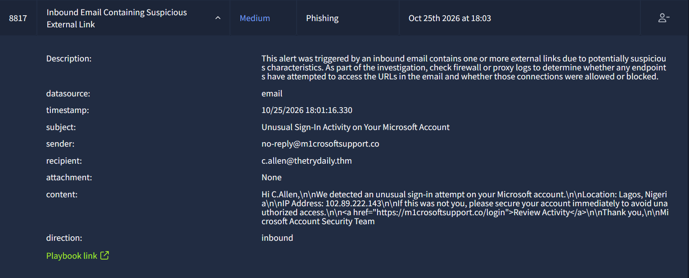
  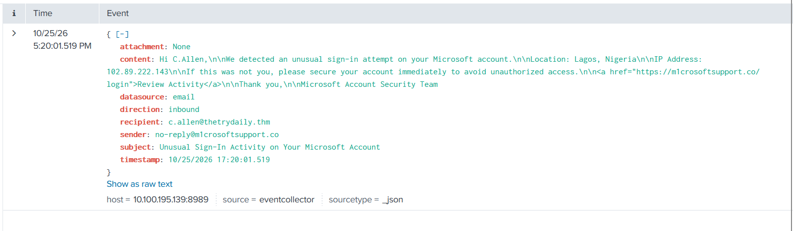

* **Final Report:**
  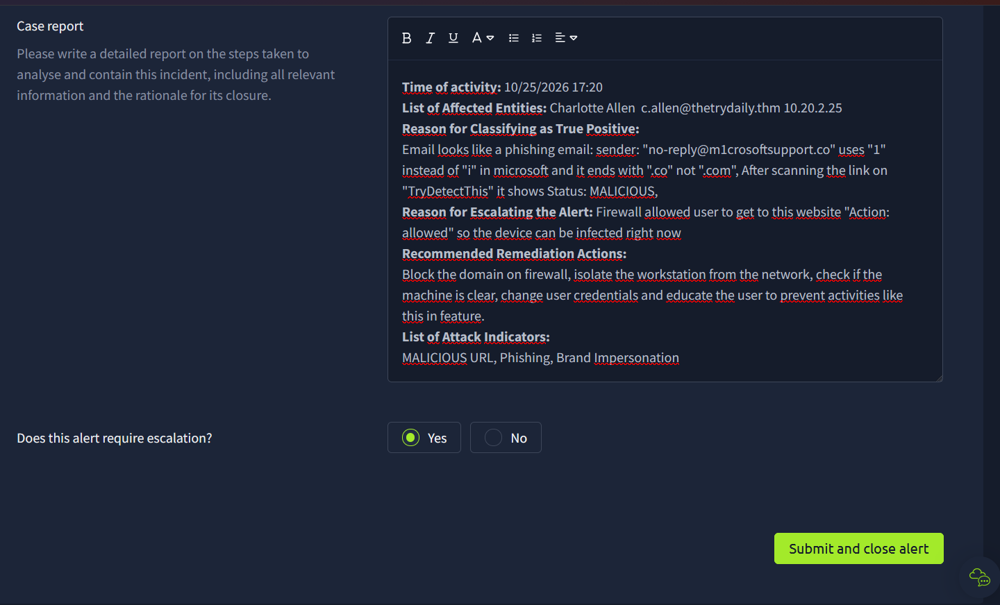
